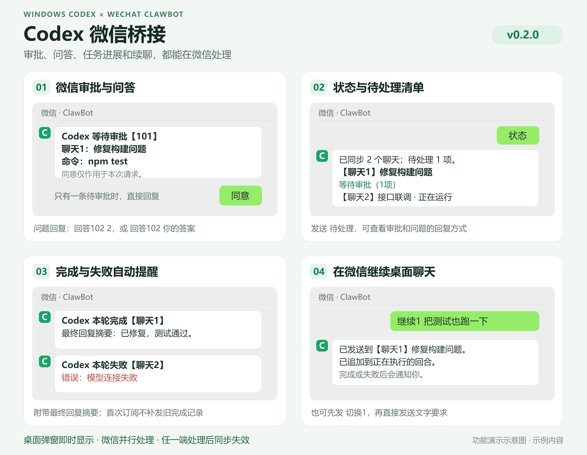

# Codex 微信桥接

在当前 Windows Codex 桌面实例旁运行，通过微信 ClawBot 收发审批、问题回答、完成/失败提醒，并继续已有聊天。当前版本：`0.2.0`。



> 使用效果示意图，消息内容为示例。图片源文件：[SVG](docs/images/usage-preview.svg)。

桌面审批弹窗正常出现；微信推送在独立进程中发送，不等待微信网络或用户回复。桌面端可以随时正常处理同一请求。桥接在提交微信回复前重新读取桌面状态，已结束的请求不会再次提交。

## 当前功能

| 功能 | 当前行为 |
| --- | --- |
| 微信审批 | 同步命令执行、文件修改、网络或文件系统权限请求；可以在微信同意或拒绝。命令与文件审批只批准本次，权限请求只授权本回合。 |
| 手机简短回复 | 纯数字请求编号、可长按复制的独立审批回复；唯一一条已通知且可用的待审批可免编号回复。 |
| 微信回答问题 | 支持原生阻塞式提问、桌面异步问题卡片；可以选择选项或填写文字，答案回填到原桌面聊天。 |
| MCP 确认与表单 | 支持 URL 确认和简单 JSON 表单；复杂表单及身份验证在桌面处理。 |
| 完成、失败和中断提醒 | 本轮完成、失败、中断或取消时推送聊天名称、最终回复摘要和错误原因（如有）；首次订阅不补发旧的完成记录，未送达结果支持重试和重启后继续发送。 |
| 查看状态与待处理清单 | 查看已同步聊天的编号、名称和运行状态，以及待审批、待回答的项目和回复方式。 |
| 微信继续已有聊天 | 选择聊天后直接发送文字，或带聊天编号发送指令；执行中追加消息，空闲时开启下一回合，并继承桌面聊天的模型、目录和审批设置。 |
| 桌面与微信并行 | 桌面弹窗即时出现，两端均可处理；提交前复查桌面状态，已结束请求不再提交，多聊天请求分别编号。 |

适用于当前 Windows 电脑上由 Codex 桌面持有、已加载的本地聊天。当前不支持微信创建新聊天、语音和图片输入；后续开发项见文末。

## 微信指令

| 发送内容 | 作用 |
| --- | --- |
| `连接` | 建立或刷新微信消息上下文。 |
| `状态` | 查看聊天编号、名称及运行状态；也支持 `聊天`、`任务`。 |
| `待处理` | 查看审批和问题清单；也支持原来的 `待办`。 |
| `同意` / `拒绝` | 处理唯一一条已通知且可用的待审批；多条审批时必须带编号。 |
| `同意101` / `拒绝101` | 处理指定审批，也支持 `同意 101` 这样的带空格格式。 |
| `回答102 2` | 问题提供选项时选择第 2 项，否则按文字 `2` 回答。 |
| `回答102 你的答案` | 给指定问题填写文字；编号与答案之间留空格。 |
| `切换1` | 选择“聊天1”，之后直接发送文字即可续聊。 |
| `继续1 把测试也跑一下` | 给“聊天1”发送指令，并将它设为当前聊天。 |
| `帮助` | 查看微信端的简要用法。 |

**聊天编号和请求编号分开**，例如“聊天1”中的“审批101”。请求使用持久化的纯数字编号，重启后不复用旧编号；聊天编号和当前选择也保存在本地。

## 回复与通知规则

- 免编号回复只处理唯一一条已通知且可用的普通审批；JSON 表单和问题按通知回复。多条审批、连接不可用或提交前列表发生变化时，带编号回复或在桌面处理。
- 问题编号与答案之间留空格；一个通知含多道问题时，每个答案一行。异步问题卡片逐题编号，简单 MCP 表单按通知填写 JSON。
- 未选择聊天且只有一个可用聊天时，可以直接发文字；有多个可用聊天时先选择。已选聊天断开后不会自动改投其他聊天。
- 续聊继承桌面的模型、目录与审批设置。存在待处理审批或问题时，先完成对应回复；`继续1` 后必须填写内容。
- “本轮完成”表示 Codex 结束本轮，任务与测试结果以最终回复为准；单个工具报错不会直接判为整轮失败。最终回复摘要最多 1800 字符。
- 首次订阅不补发旧完成记录。已观察的活动回合、未送达结果和去重记录会保存到本地；结果发送失败每 15 秒重试。正常重连不重复提醒，但发送成功后、记录落盘前进程异常退出，仍可能重复。

## 安装与运行

依赖：Windows、Node.js 20.18+、Python 3.10+；后台启动脚本还需要 PowerShell 7。确保 `node`、`npm`、`python`、`pwsh` 可从终端调用，并打开 Codex 桌面聊天。

在项目根目录打开 PowerShell 7，从源码首次安装时执行 `npm ci`，首次使用时扫码绑定：

```powershell
# 首次安装依赖
npm ci

# 首次扫码绑定微信
npm run login

# 后台启动，无额外控制台窗口
pwsh -NoProfile -File .\Start-Bridge.ps1
```

启动后在微信发送 `连接`，再发送 `状态` 查看聊天。停止或诊断时，按需单独执行：

```powershell
# 停止桥接，保留桌面 Codex
node .\src\cli.mjs stop

# 只读检查当前桌面通信和状态订阅
node .\src\cli.mjs doctor
```

后台和前台启动方式任选一种。前台可执行 `npm start` 或双击 `启动.cmd`，按 Ctrl+C 停止；也可双击 `停止桥接.cmd`、`检查连接.cmd`。同一副本只运行一个进程，联调时也不要同时运行使用同一微信绑定的多个副本。

扫码二维码显示在终端，也保存在 `data/wechat-login.png`。若微信要求配对码，在扫码终端输入。已绑定的同一副本无需每次扫码；微信回复异常时先发 `连接` 刷新上下文，凭证失效后再重新扫码。

后台日志：`data/service.log`；错误日志：`data/service-error.log`；摘要状态：`data/status.json`。后台重启时旧日志按时间重命名保留。

## 适用范围与限制

普通聊天文本里的疑问句不自动识别为问题卡片。远程主机聊天不在当前版本的自动扫描范围内。

桥接只读扫描最近 200 个本地聊天的元数据，并订阅有当前桌面持有者的聊天；新加载或新活动的聊天通过桌面事件和每 10 秒的元数据刷新发现。不会为了订阅而另起 Codex 实例或恢复未加载的旧聊天。

## 接入与兼容性

本版本使用当前桌面程序已有的本机 IPC：状态订阅及 `thread-follower-*` 请求。没有修改 Codex 安装文件、审批策略、全局配置或 hooks，没有接管聊天所有权，也没有后台推理轮询。

已核实的 Windows 包版本为 `26.1013.4894.0`，包内应用版本为 `26.1013.40934`，聊天状态协议版本为 `11`。这是内部接口，桌面升级后可能需要更新适配；协议版本、状态结构或连接异常时，微信提交暂停，桌面端继续使用。

审批由原桌面实例核对并处理，原生审批请求只能完成一次。异步问题沿用桌面自己的回答消息格式，通过当前聊天的 steer 通道提交；提交前校验问题仍属于活动回合、尚未被回答。

微信通道依据腾讯公开的 iLink 协议实现，直接扫码连接 ClawBot；无需安装完整 OpenClaw。

`data/account.json` 保存本机微信令牌，`data/weixin-state.json` 保存消息游标和回复上下文，`data/bridge-state.json` 保存聊天路由与未送达的结果摘要。分享代码时不要分享 `data/`。

源码采用明确的文件白名单：运行数据、本机配置、依赖、日志、缓存、测试产物及本机 ZIP 默认排除。新增文件先审查再放行；发布前检查暂存与已跟踪内容。Release 源码包从审查后的 Git 标签导出，不直接压缩运行目录。

默认读取环境变量 `CODEX_HOME`（未设置时为用户目录下的 `.codex`），并调用终端中的 `python`。需要覆盖时，在项目根目录创建 `config.json`：

```json
{
  "codexHome": "C:/Users/你的用户名/.codex",
  "python": "C:/路径/python.exe"
}
```

## 验证记录

在项目根目录执行 `npm test`。截至 2026-10-21，49 项自动测试通过，覆盖审批、问答、聊天路由、通知重试和重启去重等。

本机已实测微信收发、常用审批和问题回填、状态清单、运行状态提取及执行中续聊。空闲聊天开启下一回合及部分复杂权限类型仅做协议适配或模拟验证，未逐项实测。

接口参考：[Codex app-server](https://learn.chatgpt.com/docs/app-server)、[腾讯微信协议](https://github.com/Tencent/openclaw-weixin/blob/main/docs/protocol.md)。

## 后续批次（尚未开发）

1. 手机查看文件改动、测试和错误的按需摘要，以及完整最终回复。
2. 微信语音转需求、图片/截图输入。
3. 在微信中选择项目并创建新聊天。
4. 开机自启、连接自检、通知设置与免打扰。
